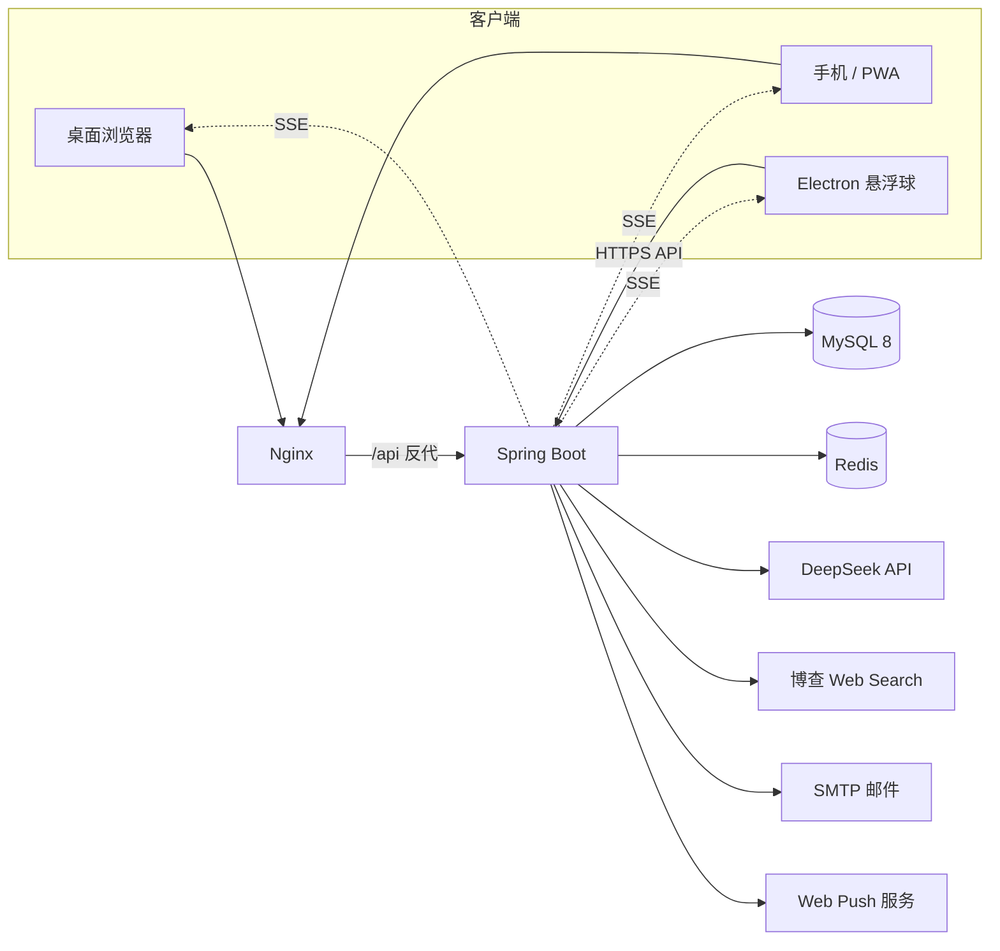
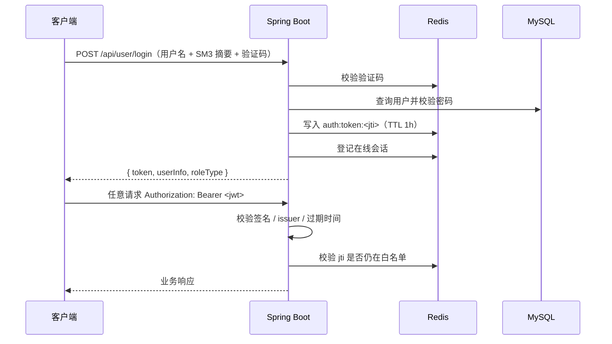
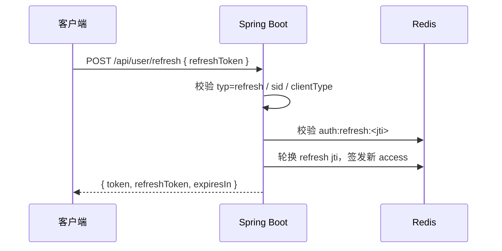
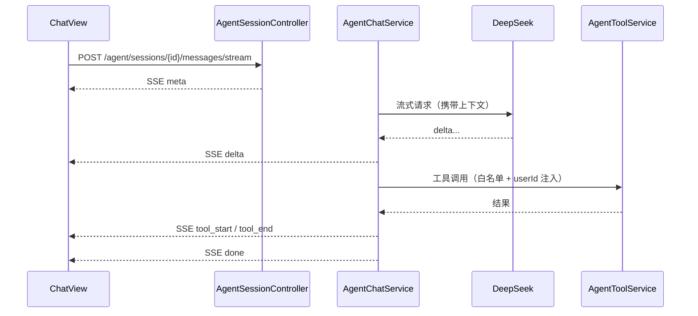

# 架构说明

> 本文记录当前实现与后续规划。标注「规划中」的部分尚未落地，避免与代码状态混淆。

## 1. 一套前端，三种承载形态

同一份 Vue 3 源码通过响应式断点与不同的构建配置服务三个环境：

| 环境 | 加载方式 | 视口 | 布局 | 状态 |
| --- | --- | --- | --- | --- |
| Windows 桌面浏览器 | Nginx 静态站点 | 宽屏 | 桌面三栏 / 双栏 | 已实现 |
| 手机浏览器 | 同一站点 | 窄屏 | ≤900px 单列 + 抽屉导航 | 已实现 |
| Electron 悬浮球 | 本地 `dist-electron/` | 可调窗口 | 桌面布局（minWidth 900） | 已实现 |
| PWA | 同一站点 + manifest | 窄屏 | 同手机浏览器 | 已实现（需 HTTPS） |

构建矩阵：

```text
npm run build          -> dist/           base "/"     history 路由  同源 /api
npm run build:desktop  -> dist-electron/  base "./"    hash 路由     绝对 API 地址
```

`file://` 下必须同时满足「相对 base + hash 路由 + 绝对 API 地址」，否则会出现白屏或接口 404。

## 2. 部署拓扑



- Nginx 负责 SPA 回退、静态资源长缓存、`sw.js` 不缓存、SSE 关闭缓冲。
- Redis 承载 JWT 白名单、验证码、找回密码验证码、在线会话、搜索缓存。

## 3. 认证流程（当前）



Refresh Token 流程（已实现，含轮换与重放撤销）：



分环境策略：

| clientType | Access | Refresh | Refresh 存储 |
| --- | --- | --- | --- |
| `DESKTOP`（Electron） | 1 小时 | 30 天 | 主进程 `safeStorage` 加密 |
| `WEB`（浏览器 / PWA） | 30 分钟 | 14 天 | localStorage（后续可换 httpOnly Cookie） |

## 4. Agent 对话与 SSE



前端用 `fetch` + 手写 SSE 解析器，支持 `AbortSignal` 取消；通知 SSE 与对话 SSE 是两条独立通道。

## 5. 后端模块

| 包 | 职责 |
| --- | --- |
| `controller` | 9 个 REST 控制器，统一返回 `{code,msg,data}` |
| `service` | 认证、Agent 运行时、任务、关系、人格、通知、Web Push、搜索 |
| `mapper` / `entity` | MyBatis-Plus 数据访问与 16 张表实体 |
| `security` / `config` | JWT 过滤器、Spring Security、线程池与配置绑定 |
| `dto` | 请求校验、响应、SQL 投影、Agent 工具结构 |
| `common` / `exception` | 统一结果与异常映射 |

数据库结构由 Flyway 管理：`V1` 基线建表、`V2` Java 迁移补索引、`V3` 人格与阶段种子数据。

## 6. 响应式约定

- 主断点 `900px`，次断点 `768px`，横屏矮视口 `(orientation: landscape) and (max-height: 500px)`。
- 移动规则全部放在 `max-width` 内；≥901px 不触发，桌面视感保持不变。
- 触控目标 ≥44×44px，输入框字号 ≥16px（避免 iOS 聚焦放大）。
- 会话列表、虚拟形象在窄屏下分别变为抽屉与底部浮层。

## 7. 相关文档

- 部署手册：`deploy/README.md`
- API 契约：`虚拟形象spring/javaweb/docs/openapi/javaweb-api.yaml`
- 产品需求：`虚拟形象spring/javaweb/需求文档.md`
