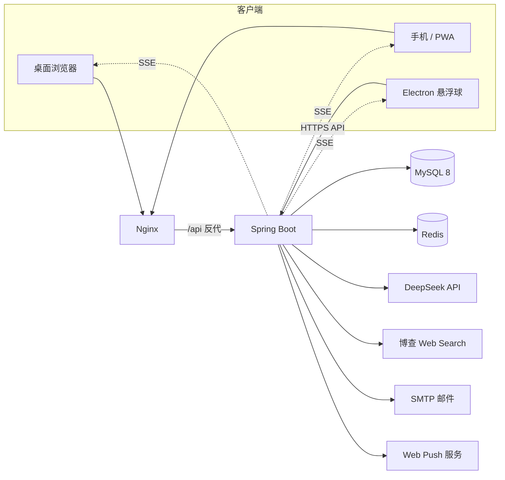
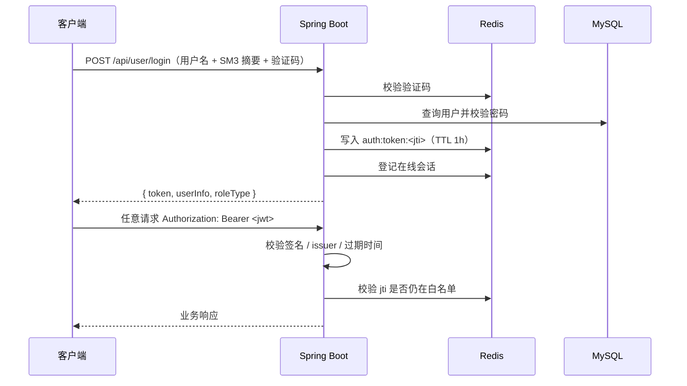
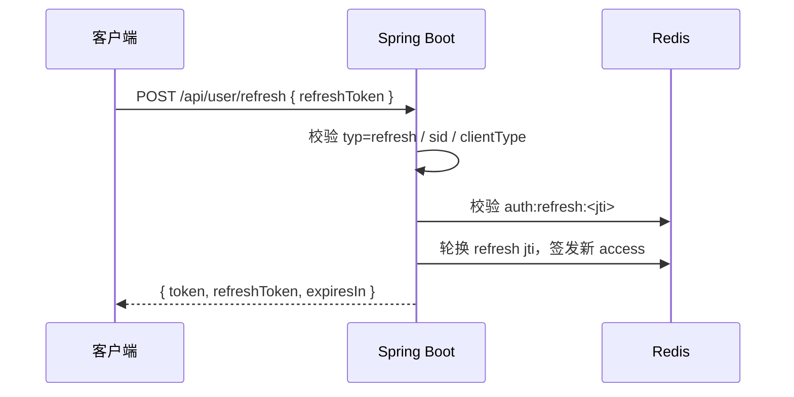
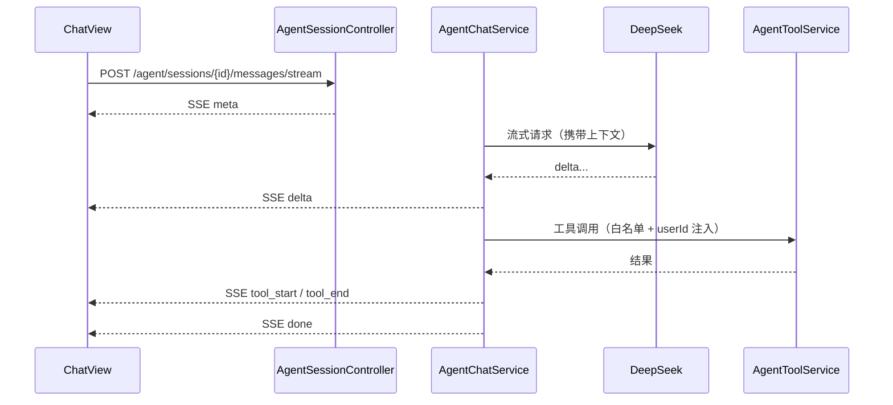

# 架构说明

> 本文记录当前实现与后续规划。标注「规划中」的部分尚未落地，避免与代码状态混淆。

## 1. 一套前端，三种承载形态

同一份 Vue 3 源码通过响应式断点与不同的构建配置服务三个环境：

| 环境 | 加载方式 | 视口 | 布局 | 状态 |
| --- | --- | --- | --- | --- |
| Windows 桌面浏览器 | Nginx 静态站点 | 宽屏 | 桌面三栏 / 双栏 | 已实现 |
| 手机浏览器 | 同一站点 | 窄屏 | ≤900px 单列 + 抽屉导航 | 已实现 |
| Electron 悬浮球 | 本地 `dist-electron/` | 可调窗口 | 桌面布局（minWidth 900） | 已实现 |
| PWA | 同一站点 + manifest | 窄屏 | 同手机浏览器 | 已实现（需 HTTPS） |

构建矩阵：

```text
npm run build          -> dist/           base "/"     history 路由  同源 /api
npm run build:desktop  -> dist-electron/  base "./"    hash 路由     绝对 API 地址
```

`file://` 下必须同时满足「相对 base + hash 路由 + 绝对 API 地址」，否则会出现白屏或接口 404。

## 2. 部署拓扑



- Nginx 负责 SPA 回退、静态资源长缓存、`sw.js` 不缓存、SSE 关闭缓冲。
- Redis 承载 JWT 白名单、验证码、找回密码验证码、在线会话、搜索缓存。

## 3. 认证流程（当前）



Refresh Token 流程（已实现，含轮换与重放撤销）：



分环境策略：

| clientType | Access | Refresh | Refresh 存储 |
| --- | --- | --- | --- |
| `DESKTOP`（Electron） | 1 小时 | 30 天 | 主进程 `safeStorage` 加密 |
| `WEB`（浏览器 / PWA） | 30 分钟 | 14 天 | localStorage（后续可换 httpOnly Cookie） |

## 4. Agent 对话与 SSE



前端用 `fetch` + 手写 SSE 解析器，支持 `AbortSignal` 取消；通知 SSE 与对话 SSE 是两条独立通道。

表演与语音在原有 `delta` 之上增加了三类事件：

| 事件 | 载荷 | 用途 |
| --- | --- | --- |
| `act` | `{emotion?, motion?, intensity, sentenceIndex}` | 驱动表情与点头/摇头/歪头/弹跳 |
| `speech` | `{index, text, emotion?}` | 按句朗读文本 |
| `done` | `{..., speechCount, emotion?}` | 收尾并恢复基线情绪 |

### 4.1 表演协议与形象运行时

- 系统提示要求模型在正文中输出 `<act emotion="..." motion="..." intensity="..."/>`；后端 `PerformanceTagParser` 流式解析并**从正文和落库内容中剥离**，`AssistantPerformanceStream` 负责按句切分、把 `act` 挂到对应句子。
- `SpeechChunker` 只影响朗读：代码块、URL、Markdown 标记不进 TTS，但不影响聊天显示。
- 前端 `avatarStore` 是形象状态中枢；`PixelStage` 只负责渲染，不再私有持有动画器。
- 运行时按 `Pose` 参数组织动作，插件链为 `pre → post → final`：呼吸、眨眼、视线、情绪、动作预设、口型、触摸依次叠加；未来接 Live2D/VRM 时替换 `StageDriver`，聊天与语音层不需要改。
- 语音开启时，`act` 延迟到对应句子的音频真正开始播放时执行，避免「先动嘴后出声」。

### 4.2 语音朗读

```
LLM 文本 → SpeechChunker → SSE speech
  → 前端 speechQueue（最多 2 路并发合成 / 3 句缓冲）
  → POST /api/tts/synthesize（JWT）
  → Spring Boot VolcengineTtsProvider（HTTP Chunked 单向流式 V3）
  → Redis 缓存 + 日字符配额
  → 浏览器 Web Audio：Source → Analyser → Gain(音量) → destination
  → pinyin-pro 韵母 viseme + Analyser 包络 → Pose.mouthOpen/viseme
```

- 供应商密钥只存后端；`/api/tts/config` 不返回密钥或上游地址。
- 缓存命中不扣配额；单条文本上限默认 300 字，日配额默认 5000 字。
- 口型取 `Analyser`（音量之前）的包络，所以音量调到 0 时嘴仍会动；说完 200ms 释放、700ms 强制闭嘴，避免 Idle 嘴角残留。
- `tts.enabled=false` 或未配置密钥时，前端隐藏语音入口，文本与表情动作仍正常。

### 4.3 形象配置

- `avatar_config`（V4）按用户保存 `{presetId, palette}`，用 `revision` 乐观锁避免多窗口互相覆盖。
- 当前像素驱动通过重绘实现配色；预设与配色字段由 `/api/avatar/catalog` 下发。
- 衣橱页面实时预览不落库，离开时恢复已保存配色；保存后聊天页重新挂载即可生效。
- 后续可把 `driver` 扩展为 `pixel-pack`，在 `StageDriver` 层接入用户模型。

### 4.4 Live2D 舞台与头像上传

- **Live2D 模型**：衣橱上传 Cubism 3/4/5 zip（≤20MB）→ `avatar_model` 表 + `uploads/live2d/{userId}/`；下载走 `/api/avatar/live2d/{id}/file`（需 JWT），前端取 `ArrayBuffer` 后交给 `live2d-renderer`，模型内部资源由 zip 解包，不暴露公共目录。
- **舞台切换**：`StageHost` 按 `avatar_config.driver` 在 `PixelStage` 与 `Live2DStage` 间切换；保存 `driver=live2d + modelId` 后聊天页立即使用该模型。
- **Live2D 口型**：`live2d-renderer` 接收 TTS 的同一段音频（`avatarStore.inputAudio`），像素舞台忽略该方法。
- **Cubism Core**：`public/live2d/live2dcubismcore.min.js` 随前端构建复制；许可证为 Live2D Proprietary Software License，商用前需确认授权。
- **头像**：`POST /api/user/avatar`（multipart，`target=user|ai`）→ 存 `uploads/avatar|ai-avatar/`，用户头像写 `user.avatar`，AI 头像写 `user_profile.ai_avatar`；图片通过 `/api/files/**` 以 UUID 文件名公开读取。multipart 单文件、请求体与内存阈值均为 20MB。

### 4.5 应用更新

```
管理员上传 exe（/api/admin/app-versions）
  → app_version 表 + uploads/updates/<uuid>.exe
  → 向所有启用用户写入 APP_UPDATE 站内信
  → SSE / Web Push 实时通知（不遵循免打扰）
  → 用户「检查更新」读取 /api/app/version/latest
  → 下载 /api/files/updates/<uuid>.exe
```

- 安装包上限 300MB；multipart 内存阈值仍为 20MB，超过部分落盘。
- 网页端随服务器自动更新；Electron 端不做自动安装，用户下载安装包后覆盖安装。
- `app_version` 版本号唯一，且必须大于当前最新版本；不能删除当前最新版本。
- 通知点击在产品内跳转 `/update`；管理员页面在 `/admin/update`。

## 5. 后端模块

| 包 | 职责 |
| --- | --- |
| `controller` | 9 个 REST 控制器，统一返回 `{code,msg,data}` |
| `service` | 认证、Agent 运行时、任务、关系、人格、通知、Web Push、搜索、语音合成、形象配置 |
| `mapper` / `entity` | MyBatis-Plus 数据访问与领域表实体（V4 新增 `avatar_config`） |
| `security` / `config` | JWT 过滤器、Spring Security、线程池与配置绑定 |
| `dto` | 请求校验、响应、SQL 投影、Agent 工具结构 |
| `common` / `exception` | 统一结果与异常映射 |

数据库结构由 Flyway 管理：`V1` 基线建表、`V2` Java 迁移补索引、`V3` 人格与阶段种子数据、`V4` 形象配置、`V5` AI 头像与 Live2D 模型表、`V6` 桌面端安装包版本表。

## 6. 响应式约定

- 主断点 `900px`，次断点 `768px`，横屏矮视口 `(orientation: landscape) and (max-height: 500px)`。
- 移动规则全部放在 `max-width` 内；≥901px 不触发，桌面视感保持不变。
- 触控目标 ≥44×44px，输入框字号 ≥16px（避免 iOS 聚焦放大）。
- 会话列表、虚拟形象在窄屏下分别变为抽屉与底部浮层。

## 7. 相关文档

- 部署手册：`deploy/README.md`
- API 契约：`虚拟形象spring/javaweb/docs/openapi/javaweb-api.yaml`
- 产品需求：`虚拟形象spring/javaweb/需求文档.md`
