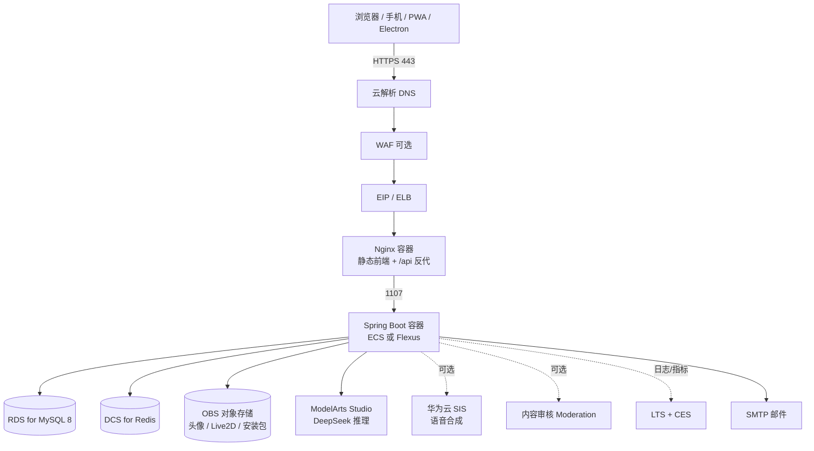

# 赛题 1 改造指南：基于华为云打造「虚拟形象 Agent」

> 适用项目：虚拟形象 Agent（Vue 3 + Spring Boot 4 + MySQL 8 + Redis）
> 目标：满足赛题「云上部署 + 可视化 Demo + 码道 CodeArts 全流程使用 + 开源」四项硬要求
> 编写日期：2026-11-25
> 使用方式：先读第 0–4 节确定策略，再按第 5–13 节逐项执行；每节末尾都有验收标准。

---

## 0. 一句话策略

**评委不会逐行看代码，他们只看三件事：应用是不是真的跑在华为云上、码道是不是真的参与了开发与部署、三分钟内能不能看懂这个产品。**

因此优先级是：

1. **先上云**（ECS/Flexus + RDS + DCS + OBS），让所有功能在公网 HTTPS 下真实可用；
2. **再补 AI 云化**（ModelArts Studio 跑大模型、可选 SIS 语音），让「AI 应用」本身也长在华为云上；
3. **同时留证据**（码道对话、截图、commit、部署日志），这是最容易丢分也最容易补分的地方；
4. **最后做 Demo 页与视频**，把前三点包装成评委 3 分钟能看懂的故事。

> 项目本身完成度已经很高（三端一体、完整账号体系、SSE、Flyway、CI），**不需要重写**。这次改造的本质是「基础设施云化 + 交付物补齐」，预计 3–4 周可完成。

---

## 1. 赛题要求 → 评委视角 → 交付物

| 赛题原文 | 评委实际想看什么 | 本项目要交付 | 优先级 |
| --- | --- | --- | --- |
| 基于华为云产品打造 AI 创新应用 | AI 能力与基础设施至少有一半在华为云上，而不是「本地跑完贴个云截图」 | 应用部署在 ECS/CCE；数据在 RDS；缓存在 DCS；文件在 OBS；LLM 走 ModelArts Studio（MaaS） | P0 |
| 云上部署，通过可视化 Demo 页面展示核心功能与交互流程 | 公网可访问、有引导、不冷场、不空数据 | 公网 HTTPS 地址 + 演示账号 + 应用内引导 + 独立展示页 | P0 |
| 体现华为云在需求理解、代码生成、项目构建、问题修复、部署上线环节的价值 | 每个环节都有**真实案例**，能说出「AI 做了什么、人改了什么」 | 五份带时间线、Prompt、截图、commit 的证据记录 | P0 |
| 下载并使用华为云码道 CodeArts 代码智能体 | 有安装/版本截图、有实际使用轨迹 | 码道账号、版本截图、对话记录、录屏 | P0 |
| 基于已有智能体和 Skills 快速开通 RDS、Redis 等华为云服务 | 资源是「智能体帮我开的」，不是手动点控制台 | Skills 会话录屏 + 控制台资源截图 + 资源 ID | P0 |
| 基于智能体和 Skills 快速部署上云 | 部署过程可复现、有流水线/脚本 | 一键部署脚本 + 部署日志 + 码道部署对话 | P0 |
| 开源至 Gitee/GitHub | 许可证、文档、可复现、无密钥 | 完整开源仓库 + LICENSE + 部署文档 + 截图/视频 | P0 |
| （隐含）作品完成度与创新性 | 有没有记忆点、能否持续使用 | 像素/Live2D 形象 + 情感养成 + 任务闭环 + 桌面常驻 | P1 |

### 一句话定位（写进 README 和提交材料）

> **面向独居年轻人的像素风 AI 陪伴助手**：把聊天、日程提醒、关系养成、形象表达合成一个可长期使用的桌面常驻应用；一套 Vue 源码同时服务浏览器、PWA 与 Electron 悬浮球。

这比「又一个 AI 聊天机器人」更容易被记住。

---

## 2. 现状盘点

### 2.1 已有优势（演示时要主动讲）

- 完整产品闭环：注册/登录/JWT/邮箱找回、Agent 对话、工具调用、任务提醒、关系养成、通知、管理端、衣橱、Live2D、TTS。
- 工程完成度高：Flyway 版本化迁移、统一异常与返回、Refresh Token 轮换、SSE 取消生成、前端手写 SSE 解析。
- 三端一体：同一份代码覆盖桌面浏览器、手机、PWA、Electron 悬浮球。
- 已有 CI（GitHub Actions 跑后端测试 + 前端构建）与 OpenAPI 契约。

### 2.2 必须补的缺口

| 缺口 | 现状 | 影响 | 工作量 |
| --- | --- | --- | --- |
| `deploy/` 目录在工作区已删除，README/docs 仍在引用 | `git status` 显示 D | 开源后文档死链、无法复现部署 | 0.5 天 |
| 没有 LICENSE / NOTICE | 仓库无许可证 | 不满足开源要求，无法参赛 | 0.5 小时 |
| 没有 Dockerfile / compose / 部署脚本 | 无 | 上云全靠手工，不可复现 | 1–2 天 |
| 文件存储在本地磁盘 `./uploads` | `FileStorageService` 用 `Files.copy` | 云上重建/多实例丢文件；300MB 安装包占系统盘 | 2–3 天 |
| MySQL / Redis 是本地安装 | 默认 localhost | 不满足「关联 RDS、Redis」硬要求 | 0.5 天（改配置）+ 开通时间 |
| 无健康检查 / 监控 / 日志接入 | 无 actuator | ELB 无法探活，出事无日志 | 0.5 天 |
| LLM 直连 DeepSeek 官方 API | `deepseek.base-url=https://api.deepseek.com` | AI 核心不在华为云，说服力弱 | 0.5–1 天 |
| 无引导式 Demo / 展示页 | 只有 `docs/demo.md` 脚本 | 「可视化 Demo 页面」要求未落地 | 2–3 天 |
| 无赛题证据材料 | 无 | 码道使用价值无法证明 | 贯穿全程 |
| 定时任务与 SSE 假设单实例 | `@Scheduled` + 进程内 `Map<userId, SseEmitter>` | 多副本会重复提醒 / 推送不到 | 比赛单实例可接受，写进文档即可 |

### 2.3 需要提前知道的风险

- **Live2D 许可证**：`live2dcubismcore.min.js` 是 Live2D 专有运行时，不能随仓库开源；仓库里只放说明，演示时本地放置。付费模型不要提交。
- **AIRI 启发**：`pose.js`、`runtime/pluginPipeline.js` 注释写明「参考/简化自 AIRI（MIT）」。MIT 兼容，但要在 NOTICE 里致谢。
- **大文件上传**：multipart 上限 520MB，经过 Nginx/ELB 时容易被默认限制或超时截断，需要显式配置并实测。
- **备案与域名**：国内公网 HTTPS + PWA + Web Push 需要已备案域名；**这一步最耗时，建议第一周就去办**，否则先用「IP + 临时自签证书」会影响 PWA 和推送演示。
- **Spring Boot 4.1.1**：很新，选基础镜像时确认 JDK 17 与依赖兼容；CI 已能跑通，容器内保持同一版本即可。
- **DeepSeek 边车**：配置里 `deepseek.proxy-enabled=true` 指向 `127.0.0.1:8787`，云上必须显式设为 `false`，否则每次请求先超时再回退。

### 2.4 动手前 30 分钟

- [ ] 把当前未提交的改动提交或建分支（`git status` 有几十个文件改动，先冻结现状）。
- [ ] 扫描 git 历史中的密钥：`git log -p | grep -iE "sk-|AKIA|password="`，确认没有泄露；有则轮换密钥。
- [ ] 注册/实名华为云账号，确认能进入 CodeArts、RDS、DCS、OBS 控制台。
- [ ] 检查域名是否已备案；没有就立刻提交备案，或准备一个已备案域名。
- [ ] 在本地装好 Docker Desktop，能跑 `docker compose up`。

---

## 3. 目标架构（华为云）

### 3.1 推荐拓扑



### 3.2 产品清单与用途

| 产品 | 在本项目中的用途 | 是否必须 | 备注 |
| --- | --- | --- | --- |
| ECS / Flexus 应用服务器 | 跑后端与 Nginx 容器 | 必须 | Flexus 更便宜，适合比赛演示 |
| RDS for MySQL 8 | 用户、任务、会话、关系、通知 | 必须 | 赛题点名 RDS |
| DCS for Redis | JWT 白名单、验证码、在线会话、搜索/TTS 缓存 | 必须 | 赛题点名 Redis |
| OBS 对象存储 | 头像、AI 头像、Live2D zip、桌面安装包 | 必须 | 当前本地磁盘必须改造 |
| ELB 弹性负载均衡 | HTTPS 终结、健康检查、未来扩容 | 建议 | 也可先 EIP 直连 Nginx |
| ModelArts Studio（MaaS） | DeepSeek-V3/R1 推理 | 强烈建议 | 让 AI 核心也上华为云 |
| SIS 语音交互 | 替换/补充火山 TTS | 可选加分 | 现有 TTS 抽象可复用 |
| 内容审核 Moderation | 输入/输出安全过滤 | 可选加分 | 生成式 AI 合规故事 |
| LTS + CES | 日志、监控、告警 | 建议 | 演示「可运维」 |
| SWR 容器镜像 | 存放后端/前端镜像 | 可选 | 用 CCE 时必需 |
| CCE 云容器引擎 | 容器编排 | 可选 | 比赛单机 Docker 足够 |
| WAF | Web 防护 | 可选 | 注意不要阻断 SSE，需实测 |
| CDN | 前端静态资源、安装包下载 | 可选 | 加分项 |
| CodeArts Repo / Pipeline | 代码托管、构建部署流水线 | 建议 | 与码道配合讲「全流程」 |
| 云解析 DNS + SCM 证书 | 域名与 HTTPS | 必须 | PWA/Web Push 前提 |

### 3.3 两档方案

**方案 A（推荐，1 天可跑通）**
- Flexus/ECS 2C4G 一台，Docker Compose 跑「Nginx + Spring Boot」两个容器；
- RDS for MySQL 2C4G（或 1C2G）、DCS Redis 1G、OBS 标准存储；
- EIP + 域名 + SCM 证书；
- 优点：故障面小、成本低、所有托管服务都能讲；足够拿分。

**方案 B（加分，3–5 天）**
- SWR 存镜像 + CCE 托管集群 + ELB + WAF + LTS；
- 适合录一段「云原生部署」视频作为加分素材；
- 注意：多副本会触发第 6.5 节的定时任务/SSE 问题，**比赛演示仍建议单副本**。

> 结论：**先做 A 并录好证据，时间富余再用 B 录一段额外视频**。不要为了 K8s 牺牲产品打磨时间。

### 3.4 预算与时间

- 预算量级：按需约 **300–800 元/月**（ECS + RDS + DCS + OBS + 带宽 + 域名证书），新用户代金券可覆盖大部分；以[华为云价格计算器](https://www.huaweicloud.com/pricing/calculator.html)为准。
- 关键路径：**域名备案（1–2 周）> OBS 改造（2–3 天）> Demo 页（2–3 天）> 其余各 0.5–1 天**。

---

## 4. 四周路线图

| 周 | 主题 | 产出 | 验收 |
| --- | --- | --- | --- |
| 第 1 周 | 地基 + 上云 | 恢复 deploy、LICENSE、Dockerfile、compose、健康检查；ECS 跑通 | 公网 IP 能打开登录页，前后端通 |
| 第 2 周 | 托管服务 + AI | RDS、DCS、OBS 全部接入；MaaS 跑通对话 | 控制台截图 + 应用真实读写云资源 |
| 第 3 周 | 码道 + Demo | Skills 开通资源、部署；应用内引导 + 展示页 | 3 分钟演示不冷场 |
| 第 4 周 | 证据 + 开源 | 五环节证据、视频、Gitee/GitHub 发布 | 提交清单全部打勾 |

> 如果只有两周：只做「第 1 周 + 第 2 周的 RDS/DCS/OBS + 最小 Demo 页 + 录屏证据」，放弃 CCE/WAF/SIS。

---

## 5. 地基：开源与交付物（P0）

### 5.1 恢复并改造 `deploy/`

当前工作区删除了 `deploy/`，但 README、`docs/architecture.md` 仍引用 `deploy/README.md`。建议恢复后重写为云端部署手册：

```text
deploy/
├── README.md                 # 云端部署总览（ECS + RDS + DCS + OBS）
├── docker/
│   ├── backend.Dockerfile
│   ├── frontend.Dockerfile
│   └── nginx.conf
├── compose/
│   ├── docker-compose.local.yml    # 本地 MySQL/Redis，开发用
│   └── docker-compose.cloud.yml    # 云上只跑 app + nginx
├── sql/00_create_database.sql      # 仅创建空库，建表交给 Flyway
└── scripts/
    ├── deploy.sh                   # 拉镜像、启动、健康检查、失败回滚
    └── backup-mysql.sh             # RDS 也可用控制台备份，脚本作为补充
```

验收：新机器按 README 从零跑通；所有路径与 README/docs 中的引用一致。

### 5.2 许可证

- [ ] 根目录新增 `LICENSE`，推荐 **Apache-2.0**（含专利授权，适合比赛与商用展示；若你更希望简单，MIT 也可）。
- [ ] 新增 `NOTICE`，至少包含：
  - Project AIRI（MIT）：Pose 抽象与插件链的参考来源；
  - Live2D Cubism Core：专有软件，不随仓库分发，使用需遵守 Live2D 许可；
  - 前端依赖：Vue / Element Plus / PixiJS / live2d-renderer 等（可只列主要项）；
  - 字体、音效、模型素材的来源与授权。
- [ ] README 增加「License」小节。

### 5.3 README 重写（评委第一眼）

建议结构（控制在 1 屏内能看懂）：

1. 一句话定位 + 3 张截图（桌面 / 手机 / Electron）；
2. 在线体验地址 + 演示账号 + 3 分钟视频链接；
3. 核心功能（6–8 条，别超过）；
4. **华为云架构图**（复用本文第 3.1 节）与「用了哪些云服务」表格；
5. 快速开始（本地 5 条命令）+ 云端部署链接；
6. 目录结构、文档索引、许可证；
7. 「开发过程」时间线：码道参与了哪些环节（链接到证据目录）。

### 5.4 密钥与仓库卫生

- [ ] 确认 `application.properties`、`.env*`、证书、AK/SK 均未入库（当前 `.gitignore` 已覆盖）。
- [ ] 删除仓库中的个人隐私：真实邮箱、手机号、服务器 IP、管理员账号密码。
- [ ] 提交前跑一次 `git grep -nE "sk-[A-Za-z0-9]{16,}|AKIA|LTAI|BEGIN.*PRIVATE KEY"`。
- [ ] 把 `package.json` 的 `author`、截图中的用户名改成可公开的信息。

---

## 6. 容器化与上云（P0）

### 6.1 后端镜像

```dockerfile
# deploy/docker/backend.Dockerfile
FROM maven:3.9-eclipse-temurin-17 AS build
WORKDIR /app
COPY 虚拟形象spring/javaweb/pom.xml .
RUN mvn -B -q dependency:go-offline
COPY 虚拟形象spring/javaweb/src ./src
RUN mvn -B -q clean package -DskipTests

FROM eclipse-temurin:17-jre
WORKDIR /app
RUN useradd -r -u 1001 app && mkdir -p /app/uploads && chown -R app /app
COPY --from=build /app/target/*.jar app.jar
USER app
ENV TZ=Asia/Shanghai \
    JAVA_TOOL_OPTIONS="-XX:MaxRAMPercentage=75 -Duser.timezone=Asia/Shanghai"
EXPOSE 1107
ENTRYPOINT ["java", "-jar", "/app/app.jar"]
```

注意：构建上下文是仓库根目录（因为路径含中文目录），`.dockerignore` 要排除 `node_modules`、`dist`、`target`、`uploads`。

### 6.2 前端镜像 + Nginx（重点：SSE 与大文件）

```dockerfile
# deploy/docker/frontend.Dockerfile
FROM node:20-alpine AS build
WORKDIR /app
COPY 虚拟形象/package*.json ./
RUN npm ci
COPY 虚拟形象/ .
RUN npm run build

FROM nginx:1.27-alpine
COPY --from=build /app/dist /usr/share/nginx/html
COPY deploy/docker/nginx.conf /etc/nginx/conf.d/default.conf
```

```nginx
# deploy/docker/nginx.conf
server {
    listen 80;
    root /usr/share/nginx/html;
    client_max_body_size 600m;          # 安装包 300MB / Live2D 500MB

    location / {
        try_files $uri $uri/ /index.html;
    }

    location = /sw.js {
        add_header Cache-Control "no-cache";
    }

    location /assets/ {
        expires 1y;
        add_header Cache-Control "public, immutable";
    }

    location /api/ {
        proxy_pass http://backend:1107;
        proxy_http_version 1.1;
        proxy_set_header Host $host;
        proxy_set_header X-Real-IP $remote_addr;
        proxy_set_header X-Forwarded-For $proxy_add_x_forwarded_for;
        proxy_set_header X-Forwarded-Proto $scheme;
        proxy_set_header Connection "";

        proxy_buffering off;            # SSE 必须
        proxy_cache off;
        chunked_transfer_encoding on;
        proxy_read_timeout 3600s;       # 对话/通知长连接
        proxy_send_timeout 3600s;
    }
}
```

### 6.3 Compose（云上只跑应用）

```yaml
# deploy/compose/docker-compose.cloud.yml
services:
  backend:
    image: swr.cn-north-4.myhuaweicloud.com/<namespace>/avatar-backend:${TAG:-latest}
    env_file: /etc/avatar-agent/env
    expose: ["1107"]
    volumes: ["/data/avatar/tmp:/app/uploads"]   # 仅临时文件，正式文件进 OBS
    restart: unless-stopped
    healthcheck:
      test: ["CMD", "wget", "-qO-", "http://127.0.0.1:1107/actuator/health"]
      interval: 30s
      timeout: 5s
      retries: 3

  nginx:
    image: swr.cn-north-4.myhuaweicloud.com/<namespace>/avatar-frontend:${TAG:-latest}
    ports: ["80:80", "443:443"]
    volumes:
      - /etc/letsencrypt:/etc/letsencrypt:ro
    depends_on: [backend]
    restart: unless-stopped
```

> 证书也可用华为云 SCM 签发后挂载；HTTPS 监听需在 nginx.conf 中补 `listen 443 ssl` 与证书路径。

### 6.4 ECS / Flexus 初始化

- [ ] 安全组：入方向只放 80/443（和临时 22）；**1107、3306、6379 绝不对公网开放**。
- [ ] 系统盘 ≥ 40GB；建议挂一块数据盘放 `/data`（日志、临时上传）。
- [ ] Docker + compose 插件；时区 `Asia/Shanghai`；开启自动快照。
- [ ] 用 `deploy/scripts/deploy.sh` 完成：登录 SWR → pull → `compose up -d` → 轮询健康检查 → 失败自动回滚上一 tag。
- [ ] 所有环境变量放 `/etc/avatar-agent/env`（600 权限），不要写进镜像或 compose 明文。

### 6.5 SSE、定时任务与多实例（面试/答辩可能被问）

- 当前 `NotificationSseService` 用进程内 `ConcurrentHashMap` 保存连接；`TaskOccurrenceScheduler` 每 5 秒扫描数据库。
- **单实例没问题**；一旦多副本：
  - 定时任务会重复执行 → 用 ShedLock（Redis）或数据库行锁；
  - 通知推送只到达持有连接的那个实例 → 需要 Redis Pub/Sub 或消息队列广播；
  - 对话 SSE 是请求内长连接，天然落在单个实例，无需处理。
- 比赛建议**明确声明「演示环境单副本」**，并在架构文档里写出扩容方案。这比假装支持多副本更加分。

### 6.6 健康检查与可观测性

- [ ] `pom.xml` 加 `spring-boot-starter-actuator`；
- [ ] `application.properties` 暴露 `health,info`，`management.endpoints.web.exposure.include=health,info`；
- [ ] `SecurityConfig` 放行 `/actuator/health`；
- [ ] 日志输出到 stdout（容器友好），ECS 上装 CES Agent / 接 LTS；
- [ ] 配 2 条告警：实例 CPU > 80%、健康检查失败；截图留证。

---

## 7. 华为云托管服务接入（P0）

### 7.1 RDS for MySQL

- [ ] 与 ECS **同 VPC、同子网**；安全组只允许应用安全组访问 3306。
- [ ] 新建空库 **用英文名**，例如 `avatar_agent`（当前本地库名是中文，云上不建议沿用）；字符集 `utf8mb4`。
- [ ] 建表仍交给 Flyway：新库首次启动自动执行 V1–V6，**不要手工导表**。
- [ ] 连接串：

```properties
spring.datasource.url=jdbc:mysql://<rds内网地址>:3306/avatar_agent?sslMode=REQUIRED&serverTimezone=Asia/Shanghai&characterEncoding=UTF-8&allowPublicKeyRetrieval=true
spring.datasource.username=${DB_USERNAME}
spring.datasource.password=${DB_PASSWORD}
```

- [ ] 连接池按实例规格调：2C4G 保持 `maximum-pool-size=10` 即可；确认 RDS 最大连接数。
- [ ] 开启自动备份（7 天）+ 慢 SQL 日志；截图。
- [ ] 管理员账号通过 SQL 提升（沿用 `deploy/README` 中的 `UPDATE user SET user_type=2`）。

### 7.2 DCS for Redis

- [ ] 与 ECS 同 VPC，安全组只允许应用访问 6379。
- [ ] 设置密码；开启 SSL 时加：

```properties
spring.data.redis.ssl.enabled=${REDIS_SSL:true}
```

- [ ] **淘汰策略选 `noeviction`**（或确认 `auth:*` 键不会被淘汰）。JWT 白名单键被淘汰 = 用户随机掉线，这是容易踩的坑。
- [ ] 键继续用现有前缀（`auth:token:*`、`auth:refresh:*` 等），在文档里列一张「Redis 键用途表」，答辩时可以讲。
- [ ] 演示前预热：验证登录、验证码、在线用户、搜索缓存都命中 DCS（可在控制台监控里截图 QPS）。

### 7.3 OBS 对象存储（本次最大的代码改造）

当前 `FileStorageService` 直接写本地磁盘，云上必须抽象成对象存储。

**目标设计：**

```text
ObjectStorage (interface)
├── LocalObjectStorage   # 保持现有行为，本地开发/测试
└── ObsObjectStorage     # 华为云 OBS，@ConditionalOnProperty(app.storage.provider=obs)
```

- 方法保持 `storeImage / storeZip / storeInstaller / load / delete`，Controller 不动；
- 对象 Key 直接用现有相对路径：`avatar/<userId>/xxx.png`、`live2d/<userId>/xxx.zip`、`updates/<uuid>.exe`；
- 数据库里存相对路径，**不要存完整 URL**，换域名/换存储不影响历史数据。

**配置：**

```properties
app.storage.provider=${STORAGE_PROVIDER:local}
app.storage.obs.endpoint=${OBS_ENDPOINT:}
app.storage.obs.bucket=${OBS_BUCKET:}
app.storage.obs.ak=${OBS_AK:}
app.storage.obs.sk=${OBS_SK:}
app.storage.obs.key-prefix=${OBS_KEY_PREFIX:avatar}
```

SDK（版本以最新稳定版为准）：

```xml
<dependency>
  <groupId>com.huaweicloud</groupId>
  <artifactId>esdk-obs-java-bundle</artifactId>
  <version>3.x.x</version>
</dependency>
```

**实现要点：**

- [ ] 桶设为**私有**，服务器端加密可选开启；
- [ ] 公开图片（头像）走「后端鉴权后 302 到短时签名 URL」，或保持 `/api/files/**` 由后端流式转发；
- [ ] Live2D 模型继续要求 JWT，由后端取对象后流式返回（保持现有安全语义）；
- [ ] 上传仍保留 magic bytes 校验（PNG/JPEG/GIF/WEBP、ZIP、MZ）；大文件直接 `putObject(InputStream)` 流式写入，避免整文件进内存；
- [ ] IAM 用**子用户 + 最小权限**（只允许该桶的 Get/Put/Delete/List），AK/SK 放环境变量或 DEW，**绝不入仓**；
- [ ] 迁移老数据：本地 `uploads/` 一次性脚本上传到 OBS，保持相对路径不变；
- [ ] 单元测试用 Local 实现；OBS 实现做一次手工集成验证（上传→读回→删除）。

**如果时间不够的降级方案：** 保留本地存储，但挂载一块独立数据盘到 `/app/uploads`，并在文档里明确写「单实例 + 数据盘」，同时把 OBS 作为下一步规划。**但这会明显削弱云服务的说服力，建议至少把头像和安装包迁到 OBS。**

### 7.4 网络、域名与 HTTPS

- [ ] 域名解析到 EIP/ELB；申请 SCM 证书（或 Let's Encrypt）。
- [ ] 强制 HTTPS；`X-Forwarded-Proto` 传给后端（SSE 与前端判断需要）。
- [ ] PWA、Web Push、Electron 生产构建都依赖 HTTPS/绝对地址：
  - `VITE_API_BASE_URL=https://你的域名/api` 用于 Electron 构建；
  - Web 端保持同源 `/api`，不需要 CORS。
- [ ] 登录/验证码/TTS 接口加限流（Nginx `limit_req`），防止演示账号被刷。
- [ ] 开通 WAF 时先用观察模式，确认 SSE、大文件上传不受影响再拦截。

---

## 8. 华为云 AI 能力（P1，拉开差距）

### 8.1 用 ModelArts Studio 替换 DeepSeek 官方 API

项目已经用 Spring AI 的 OpenAI 兼容协议（`spring-ai-starter-model-openai`），换 MaaS 只需要改配置：

```properties
deepseek.base-url=${LLM_BASE_URL:https://api.modelarts-maas.com/v1}
deepseek.api-key=${LLM_API_KEY:}
deepseek.model=${LLM_MODEL:deepseek-v3}
deepseek.proxy-enabled=false
```

注意事项：

- [ ] 区域与 endpoint 以 MaaS 控制台开通页为准（目前常见为「西南-贵阳一」）。
- [ ] **上下文窗口变小**：MaaS 上的 DeepSeek-V3/R1 常见为 32K，而当前 `agent.context.max-chars=80000` 是按 128K 设计的，必须下调（建议 20000–24000 字符）并复测长会话。
- [ ] 验证三件事：流式输出、工具调用（function calling）、`<act/>` 表演标签解析是否正常。
- [ ] 给评委看的证据：控制台「在线推理/API Key」截图 + 后端日志中的上游地址（脱敏）。
- [ ] 建议把配置项从 `deepseek.*` 逐步改名为 `llm.*`（保留旧变量兼容），避免文档里出现「用华为云却叫 deepseek」的违和感。

### 8.2 华为云 SIS 语音合成（可选）

- 现有 `tts` 包是 provider 结构（`VolcengineTtsProvider`），新增 `HuaweiTtsProvider` 即可；
- `tts.provider=huawei` 切换，火山作为回退；
- SIS 合成按句调用，与现有「按句排队」逻辑天然匹配；
- 用同一套 Redis 缓存与日配额，避免重复计费；
- 演示时对比音色，讲「可插拔 TTS 供应商」。

### 8.3 内容审核 Moderation（可选，合规加分）

- 在对话输出落库前调用 Moderation 文本审核；命中则替换为安全回复并记录；
- 在 README/答辩里讲「生成式 AI 内容安全」；
- 注意调用延迟：异步或只对高风险场景（首次对话、敏感词命中）审核，避免拖慢 SSE。

### 8.4 其他可选项（时间富余再做）

- OBS 图片处理 + CDN：头像自动缩放、安装包加速下载；
- SMN 告警通知到邮箱/短信；
- 云监控 CES 大屏截图放进 PPT；
- CodeArts Pipeline 串起「构建 → 推 SWR → 部署 ECS」。

---

## 9. 码道 CodeArts 使用与证据链（P0）

> 这一节决定「华为云产品使用价值」能拿多少分。**证据要在做的过程中留，不能事后补。**

### 9.1 准备

- [ ] 下载并安装华为云码道（CodeArts）代码智能体，登录华为云账号；
- [ ] 记录版本号、安装界面、账号信息（脱敏）截图；
- [ ] 把仓库导入 CodeArts Repo（或从 Gitee/GitHub 关联），保留 `main` 分支；
- [ ] 在项目内初始化 Skills 目录（码道会自动加载 `.codeartsdoer/skills/`）。

### 9.2 使用华为云 Skills

比赛强调「基于已有智能体和 Skills」。优先使用**比赛/控制台已提供的智能体与 Skills**；若需要安装官方技能集，常见方式为：

```bash
npx skills add huaweicloud/huaweicloud-skills --all --agent codearts-agent
```

- 安装后在项目 `.codeartsdoer/skills/` 下可见；
- 可用 `find-skills` 检索并加载具体技能（如 ECS 登录、RDS/Redis 开通、部署）；
- **以你所用版本的控制台/文档为准**，把实际执行的命令与输出截图保存。

### 9.3 五环节的具体做法

| 环节 | 在本项目中让码道做什么 | 留存证据 |
| --- | --- | --- |
| 需求理解 | 把赛题 + `docs/architecture.md` + 本文档喂给码道，让它输出「改造差距清单与实施顺序」，与本文对比 | 对话截图、生成的方案 md、你的批注 |
| 代码生成 | 生成 OBS 存储适配器、Dockerfile、nginx.conf、`/actuator/health`、Demo 引导组件 | diff、commit、编译/测试结果 |
| 项目构建 | 让码道解释并修复 Maven/npm 构建失败；生成 CodeArts 构建任务 | 构建日志、流水线截图 |
| 问题修复 | 把真实报错（SSE 被代理断开、OBS 403、Flyway baseline、Redis 连不上 SSL）交给码道定位 | 报错原文 → 分析 → 修复 commit → 复测截图 |
| 部署上线 | 用 Skills 开通 ECS/RDS/DCS/OBS，执行部署脚本，验证公网 URL | 资源开通会话录屏、控制台资源列表、部署日志、访问成功截图 |

**Prompt 写法建议：**

- 给上下文，不要只给一句话：贴文件路径、关键代码、完整报错、期望行为；
- 要求它先给方案再改代码，便于你判断；
- 每次修改要求附「验证方式」，例如「运行 `./mvnw test` 并说明预期输出」；
- 让它输出可直接提交的 diff，而不是泛泛而谈。

### 9.4 证据目录

```text
docs/competition/
├── README.md                    # 时间线总览：日期 / 环节 / 目标 / commit / 结果
├── codearts/
│   ├── prompts/                 # 每次关键对话的输入与输出（md）
│   ├── screenshots/             # 安装、对话、构建、部署、资源开通
│   └── recordings/              # 2–3 段关键操作录屏（mp4）
├── deployment/
│   ├── rds.md                   # 规格、库名、截图、连接方式（不含密码）
│   ├── dcs.md
│   ├── obs.md
│   └── ecs.md
└── demo/
    ├── screenshots/
    └── video-link.md
```

### 9.5 让证据可检索

- Commit message 加一行：

```text
Assisted-by: CodeArts 码道
```

- 每个关键 commit 在 `docs/competition/README.md` 里对应一行「时间 / 环节 / 做了什么 / commit」；
- 视频里出现控制台时，资源名统一带 `avatar-demo` 前缀，方便评委识别。

### 9.6 反例（不要这样）

- 只在 README 写一句「本项目使用了码道」；
- 用码道生成了无关紧要的样板代码；
- 截图里看不到账号、时间、资源名；
- 事后补截图，时间线与 commit 对不上；
- 全程让 AI 写，自己讲不清代码为什么这么设计。

---

## 10. 可视化 Demo 页面（P0）

赛题写的是「通过可视化 Demo 页面展示核心功能与交互流程」，建议做成两层。

### 10.1 第一层：应用内引导（`/tour`）

- 一个轻量的步骤浮层（自己写，不引入新依赖），按顺序高亮：
  1. 新建会话 → 流式回复；
  2. 工具调用 chip（任务/记忆/联网搜索）；
  3. 形象表情与口型（`<act/>` 驱动）；
  4. 新建 1 分钟后到点的任务 → 提醒 + 通知；
  5. 关系阶段与亲密度；
  6. 衣橱换装 / Live2D 切换；
  7. 手机布局（DevTools 或真机）；
  8. PWA 安装 / Electron 悬浮球。
- 右下角「跳过引导」；引导状态存 localStorage；首次登录自动弹出。
- 关键：**每一步都有真实数据，不能出现空状态**。

### 10.2 第二层：公开展示页（`/showcase`，免登录）

- Hero：一句话定位 + 30 秒视频 + 「立即体验」按钮；
- 三张功能卡：陪伴对话 / 任务提醒 / 形象表达；
- **华为云架构图**：本文 3.1 节，标注每个云产品；
- 「开发过程」时间线：码道在五个环节的截图缩略图（点击放大）；
- 底部：源码地址、部署文档、演示账号。

### 10.3 演示账号与数据

- [ ] 建 `demo` 账号（密码写在 README/showcase，定期轮换），或做「一键体验」短时令牌；
- [ ] 预置：1 个人格、3 个会话（含工具调用与表演标签）、5 个任务（其中 1 个 1 分钟后到点）、亲密度 S2、已保存的衣橱配色；
- [ ] 每日凌晨重置演示数据（定时任务或脚本）；
- [ ] 限制：演示账号禁用管理端、限制 TTS/LLM 日配额、登录接口限流；
- [ ] 演示数据不要包含真实用户信息。

### 10.4 视频脚本（3 分钟）

| 时间 | 画面 | 旁白要点 |
| --- | --- | --- |
| 0:00–0:20 | 桌面端首屏 + 手机 + 悬浮球 | 一套代码，三种形态 |
| 0:20–0:50 | 对话流式输出、工具调用、形象动作 | 不是普通聊天，是「有形象、有记忆、有任务」的陪伴 |
| 0:50–1:20 | 新建任务 → 到点通知 → 点击跳转 | 闭环：提醒会真的发生 |
| 1:20–1:50 | 华为云控制台：RDS / DCS / OBS / ECS | 数据、缓存、文件、应用全部托管在华为云 |
| 1:50–2:20 | 码道：对话 + Skills 开通 + 部署日志 | 从想法到上线的全过程 |
| 2:20–2:50 | 手机 PWA / Electron 通知 | 可持续使用的形态 |
| 2:50–3:00 | 架构图 + 源码地址 | 开源与后续规划 |

要求：1080p、字体够大、遮住 AK/SK/账号 ID、加字幕；上传 B 站/YouTube 并在 README 放链接，同时把 mp4 放到仓库 Release。

### 10.5 截图清单

- [ ] 桌面 1440×900：聊天、任务、关系、衣橱、管理端；
- [ ] 手机 390×844：聊天、抽屉导航、底部形象浮层；
- [ ] Electron：悬浮球、展开窗口、Windows 原生通知；
- [ ] 华为云：RDS、DCS、OBS、ECS 资源列表（脱敏）；码道对话与部署；
- [ ] 架构图（可用 mermaid 导出 PNG）。

---

## 11. 开源发布（P0）

### 11.1 仓库结构建议

```text
README.md                  # 定位、截图、体验地址、架构、快速开始、许可证
LICENSE                    # Apache-2.0
NOTICE                     # AIRI / Live2D / 第三方依赖
docs/
  architecture.md
  desktop.md
  demo.md
  huaweicloud-deploy.md     # 或指向 deploy/README.md
  华为云赛题改造计划.md      # 本文
  competition/              # 证据材料
deploy/                    # Dockerfile / compose / nginx / scripts
虚拟形象/                   # 前端
虚拟形象spring/javaweb/     # 后端
```

### 11.2 发布清单

- [ ] Gitee 主仓库 + GitHub 镜像（用「导入仓库」保持同步）；
- [ ] 打 tag：`v1.0.0-contest`，Release 里附演示视频、截图、部署包（可选）；
- [ ] 确认克隆后按 README 能跑起来（找一台干净机器或让朋友试一次）；
- [ ] README 顶部加徽章：构建状态、License、在线体验；
- [ ] 加一段英文简介（全球总决赛需要）；
- [ ] 提交前再次确认：无密钥、无真实用户数据、无 Live2D Core、无付费模型。

---

## 12. 合规与风险

| 风险 | 处理 |
| --- | --- |
| Live2D Cubism Core 专有许可 | 不入库；README 说明需自行放置；演示用自带像素形象或已授权模型 |
| Live2D 模型/素材版权 | 只用自制或明确允许演示的模型；注明来源 |
| AIRI（MIT）参考 | NOTICE 致谢；保留源码注释 |
| 生成式内容安全 | 可选接入 Moderation；界面注明「AI 生成内容仅供参考」 |
| 个人信息保护 | 最小化收集；密码加盐摘要；上传文件私有；演示账号不含真实数据 |
| 账号注销/数据导出缺失 | 若评委追问，作为「后续规划」如实说明；有时间可补注销接口 |
| 第三方 API（博查/火山/DeepSeek） | 密钥仅服务端；演示前检查余额与限流 |
| 备案 | 提前办理；未备案时用已备案域名或临时跳过 PWA 演示 |
| 比赛规则 | 如实披露 AI 辅助开发；不抄袭；开源许可证与依赖兼容 |

---

## 13. 提交前总验收清单

### 云上
- [ ] 公网 HTTPS 可访问，登录 → 对话 → 任务 → 通知全流程可用；
- [ ] 控制台可见 RDS、DCS、OBS、ECS 资源，截图已脱敏；
- [ ] 应用重启后数据不丢（RDS）、文件可读（OBS）、登录态正常（DCS）；
- [ ] `/actuator/health` 正常，ELB/健康检查通过；
- [ ] 大文件上传（Live2D ≤20MB、安装包 ≤300MB）实测通过；
- [ ] MaaS 对话可用，长会话不超上下文。

### 码道
- [ ] 安装/版本截图；
- [ ] 五个环节各有 1 个真实案例；
- [ ] Skills 开通 RDS/DCS（及 ECS/OBS）的录屏；
- [ ] 部署过程录屏 + 部署日志；
- [ ] `docs/competition/README.md` 时间线与 commit 对得上。

### Demo
- [ ] `/tour` 八步引导不冷场、无空数据；
- [ ] `/showcase` 免登录可看，含架构图与开发时间线；
- [ ] 演示账号可用、已限流、每日重置；
- [ ] 3 分钟视频已上传并放链接；
- [ ] 桌面/手机/Electron 截图齐全。

### 开源
- [ ] LICENSE + NOTICE；
- [ ] README 可让陌生人 5 分钟跑起来；
- [ ] `deploy/` 完整且与文档一致；
- [ ] Gitee/GitHub 双仓、tag、Release；
- [ ] 无密钥、无隐私、无 Live2D Core。

### 合规
- [ ] 第三方素材授权说明；
- [ ] 演示数据已脱敏；
- [ ] 比赛要求的作品简介/团队信息等材料单独准备。

---

## 14. 建议的下一步（按顺序）

1. **恢复 `deploy/` + 写 Dockerfile/compose/nginx**，在本地 Docker 里跑通「前端 + 后端 + MySQL + Redis」；
2. **加 actuator 健康检查与安全放行**，为 ELB 做准备；
3. **做 OBS 存储适配器**（接口 + 两个实现 + 迁移脚本），这是上云的最大代码改动；
4. **开 RDS/DCS/OBS 并切配置**，用码道 Skills 操作并录屏；
5. **换 MaaS**，下调上下文预算，复测对话与工具调用；
6. **做 `/tour` 与 `/showcase`**，准备演示账号与种子数据；
7. **整理证据 + 录视频 + 开源发布**。

---

## 参考链接

> 以下链接用于查证产品与操作方式，访问时以华为云官方最新文档为准。

- 华为云码道（CodeArts）代码智能体产品页：<https://www.huaweicloud.com/intl/zh-cn/product/codearts/ai.html>
- 码道 Subagent/Skill 最佳实践：<https://support.huaweicloud.com/bestpractice-codeartsagent/codeartsagent_bp_0055.html>
- 码道 + Skill 全流程交付案例：<https://bbs.huaweicloud.cn/blogs/477480>
- 码道全栈项目一键部署（ECS/RDS/OBS）实践：<https://bbs.huaweicloud.cn/forum/thread-0212721844829088104-1-1.html>
- find-skills 与 huaweicloud-skills 使用：<https://blog.51cto.com/u_15214399/14529415>
- ModelArts Studio（MaaS）最佳实践：<https://support.huaweicloud.com/bestpractice-modelarts/>
- 华为云价格计算器：<https://www.huaweicloud.com/pricing/calculator.html>

---

> 维护建议：每完成一节就把对应复选框打勾，并在 `docs/competition/README.md` 记一行日期与 commit。本文档本身也可以作为「需求理解」环节的码道输入材料。
